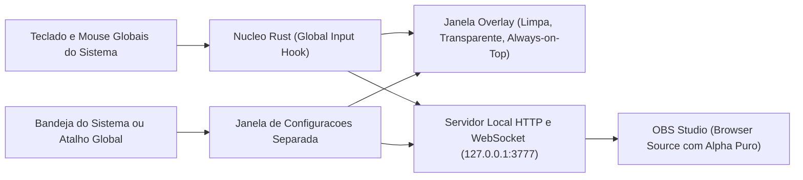

# Teglato

Um gatinho reativo de área de trabalho inspirado no **LittleOne (小只)** — leve, 100% vetorial, com janela transparente sempre no topo (*always-on-top*), interface completamente limpa e integração nativa com **OBS Studio**.

> [!NOTE]
> **Status do Projeto:** Em fase inicial de planejamento e documentação. O código-fonte ainda não foi implementado; este repositório contém apenas a documentação de arquitetura e o guia do projeto.

---

## Principais Funcionalidades

- **Arte 100% Vetorial Procedural (Canvas 2D):** Visual fiel ao original, com proporções limpas, cauda fluida, inclinação sutil da cabeça/olhos e cinemática inversa 2D suave nas patas para alcançar cada tecla com naturalidade a 60 FPS — sem depender de dezenas de *sprites* pesados.
- **13 Pelagens Incluídas:** Troca instantânea entre todas as pelagens clássicas já liberadas desde o início:
  `Tuxedo` (Frajola), `Orange tabby`, `Brown tabby`, `Calico`, `Siamese`, `Black`, `White`, `Blue gray`, `Gray & white`, `Orange & white`, `Tortoiseshell`, `Cream` e `Silver`.
- **Sincronia em Tempo Real de Teclado e Mouse:**
  - Cada tecla física pressionada acende e abaixa na tecla exata do mini teclado em perspectiva, enquanto a pata correspondente (esquerda ou direita) estica até aquela coordenada.
  - Teclados em outros layouts (como **ABNT2 / PT-BR**) são mapeados automaticamente para a tecla física equivalente na grade compacta original de 5 fileiras, garantindo que nenhuma tecla fique sem resposta.
  - Suporte completo a **uso simultâneo** de mouse + teclado (uma pata segura e desliza o mini mouse enquanto a outra digita normalmente).
- **Ciclo de Vida, Sono e Despertar:** Piscadas naturais em intervalos aleatórios, balanço contínuo da cauda, modo sono após inatividade (olhos fechados, cauda apoiada na mesa e partículas `"Zzz"`) e animação de chacoalhar a cabeça ao acordar com o primeiro toque.
- **Overlay Limpo Sempre no Topo:** Janela sem bordas (`frameless`), fundo transparente real e *Always on Top* sobre outros aplicativos e jogos em modo janela/borderless. Possui *click-through* automático nas áreas transparentes e modo **Travar Posição** (*click-through* total sobre o gato inteiro). Zero botões, barras ou menus sobre a janela do pet.
- **Configurações Discretas:** Uma janela de configurações separada abre exclusivamente pelo ícone na **Bandeja do Sistema (System Tray)** ou por atalhos globais:
  - `Ctrl + Shift + ,` — Abrir / fechar a janela de configurações.
  - `Ctrl + Shift + L` — Travar / destravar posição da janela do gato (*click-through* total).
- **Integração Nativa com OBS Studio:** Servidor local embutido (`http://127.0.0.1:3777/?obs=1`) para adicionar como **Fonte de Navegador (*Browser Source*)** no OBS com canal Alpha 100% transparente e nítido, independente da posição do gato na sua tela (além de opção de fundo *Chroma Key* como alternativa).
- **Efeitos Sonoros Opcionais:** Motor de áudio sintetizado via Web Audio API (cliques suaves de teclado, clique de mouse e ronronar leve ao dormir), sem arquivos externos e com controle de volume e *mute*.
- **Privacidade por Padrão:** O hook global lê apenas o código físico da tecla (*keycode*) e a posição relativa do cursor para animar as patas. Nenhum texto digitado, senha ou dado pessoal é armazenado ou enviado pela rede.

---

## Por que Tauri v2 (Rust + TypeScript)?

Como o objetivo principal do **Teglato** é gerar um executável leve ("baixou, rodou") para qualquer pessoa — inclusive usuários leigos — mantendo baixo consumo em segundo plano e alta facilidade de modificação para contribuidores, a arquitetura adotada é **Tauri v2** (núcleo nativo em **Rust** + interface e renderização em **TypeScript / HTML5 Canvas 2D**).

| Critério | Tauri v2 (Rust + TS) | Electron (Node + Chromium) | C# / .NET (WPF / WinUI) | Godot Engine |
| :--- | :--- | :--- | :--- | :--- |
| **Tamanho final para baixar** | ~6–12 MB (portátil ou instalador) | ~120+ MB | ~65–80 MB (self-contained) | ~40–70 MB |
| **Consumo de RAM em uso** | ~35–60 MB | ~180–300 MB | ~50–90 MB | ~80–140 MB |
| **Pré-requisitos no Windows 10/11** | Zero (WebView2 já vem nativo) | Zero | Zero (se empacotado) | Zero |
| **Reúso direto no OBS (Browser Source)** | 100% (mesmo código Canvas 2D) | 100% (mesmo código Canvas 2D) | Exige reescrever cena em Web | Exige export Web separado |
| **Multiplataforma** | Windows, macOS e Linux | Windows, macOS e Linux | Foco em Windows | Windows, macOS e Linux |
| **Facilidade para contribuidores** | Alta (90% do projeto em TS/Canvas) | Alta | Média (C# + XAML) | Média (GDScript + cenas binárias) |

Em resumo: o **Rust** fica restrito a uma camada pequena e estável de sistema operacional (hook global, transparência/click-through, bandeja do sistema e servidor local do OBS), enquanto **toda a parte visual, pelagens, teclado, animações e áudio** fica em **TypeScript + Canvas 2D** — simples de entender, editar e reaproveitar tanto na janela do desktop quanto no OBS Studio.

---

## Arquitetura e Estrutura Prevista

### Fluxo de Dados



### Estrutura de Pastas Planejada

```text
teglato/
├── package.json                 # Dependências do frontend e scripts de build Tauri
├── vite.config.ts               # Empacotamento do renderer (Overlay + Settings)
├── tsconfig.json                # Configuração TypeScript
├── src/                         # ~90% do código (visual, animações, som e UI)
│   ├── shared/
│   │   ├── types.ts             # Tipos compartilhados (Config, InputEvent, Coats)
│   │   └── keyMap.ts            # Mapa do teclado compacto original + fallback ABNT2 -> ANSI
│   ├── renderer/
│   │   ├── overlay.html         # Cena 100% limpa (Desktop Overlay e OBS Browser Source)
│   │   ├── overlay.ts           # Loop 60 FPS, máquina de estados e sincronia IPC/WS
│   │   ├── settings.html        # Janela separada de configurações (Tray / Atalho)
│   │   ├── settings.ts          # Seletor das 13 pelagens, escala, áudio, OBS e atalhos
│   │   ├── audio/
│   │   │   └── soundEngine.ts   # Síntese Web Audio API opcional (teclas, mouse, ronronar)
│   │   └── rig/
│   │       ├── coats.ts         # Definições visuais das 13 pelagens
│   │       ├── deskRenderer.ts  # Desk mat, mini mouse móvel e teclado em perspectiva
│   │       ├── catRenderer.ts   # Corpo, cabeça, olhos, cauda e patas com IK 2D
│   │       └── particles.ts     # Partículas "Zzz" do modo sono
└── src-tauri/                   # Camada nativa enxuta em Rust
    ├── Cargo.toml               # Crates nativas (tauri, rdev/hook, tray, tokio/ws)
    ├── tauri.conf.json          # Permissões, janela transparente e empacotamento
    ├── icons/                   # Ícones da bandeja do sistema e executável
    └── src/
        ├── main.rs              # Ponto de entrada do binário
        ├── lib.rs               # Gerenciamento das janelas Overlay e Settings, Tray e atalhos
        ├── input_hook.rs        # Captura global de teclado/mouse + controle de click-through
        ├── obs_server.rs        # Servidor HTTP + WebSocket local (127.0.0.1:3777)
        └── store.rs             # Persistência local de pelagem, posição, escala e áudio
```

---

## Como Usar (Usuário Final — Fluxo Previsto)

1. **Baixar e Executar:** Baixe o executável portátil (`.exe`) ou instalador na página de *Releases* e abra normalmente — não exige instalação de runtimes extras no Windows 10/11.
2. **Posicionar e Travar:** Arraste o gato para o canto desejado da tela. Use `Ctrl + Shift + L` (ou o menu na Bandeja do Sistema) para travar a posição e ativar o *click-through* total sobre ele.
3. **Abrir Configurações:** Clique no ícone do **Teglato** perto do relógio do Windows (*System Tray*) ou pressione `Ctrl + Shift + ,` para trocar entre as 13 pelagens, ajustar escala, tempo de sono e áudio.
4. **Usar no OBS Studio (Transparência Perfeita):**
   - No OBS, clique em **+ (Adicionar Fonte)** → **Navegador (*Browser Source*)**.
   - Informe a URL `http://127.0.0.1:3777/?obs=1`.
   - O fundo já entra 100% transparente por canal Alpha, sem precisar configurar *Chroma Key*.

---

## Desenvolvimento, Customização e Build (Contribuidores)

### Pré-requisitos para Compilar Localmente

- **Node.js** (LTS recomendado) e **npm**.
- **Rust** (instalado via [`rustup`](https://rustup.rs/)).
- **No Windows:** **Microsoft Visual Studio C++ Build Tools** (workload *Desenvolvimento para desktop com C++*). O **WebView2** já vem pré-instalado no Windows 10/11.

### Comandos Previstos

```bash
# 1. Instalar dependências do frontend
npm install

# 2. Rodar em modo de desenvolvimento (hot-reload do Canvas + backend Rust)
npm run tauri dev

# 3. Gerar o executável e instaladores finais (Windows .exe / .msi)
npm run tauri build
```

> [!TIP]
> Futuramente será configurado um workflow no **GitHub Actions** para gerar os executáveis finais automaticamente na nuvem a cada *release*, evitando que colaboradores que alterem apenas o frontend precisem compilar localmente para distribuir.

### Guia Rápido de Manutenibilidade

Quem quiser customizar ou estender o **Teglato** raramente precisará alterar código Rust:

- **Adicionar novas pelagens:** Edite apenas `src/renderer/rig/coats.ts` adicionando um novo objeto de paleta e padrão de manchas/listras.
- **Ajustar proporções, expressões ou animações:** Edite `src/renderer/rig/catRenderer.ts` e `src/renderer/rig/particles.ts`.
- **Modificar teclado, mouse ou mesa:** Edite `src/renderer/rig/deskRenderer.ts` e o mapeamento em `src/shared/keyMap.ts`.
- **Alterar efeitos sonoros:** Edite `src/renderer/audio/soundEngine.ts`.
- **Alterar a tela de configurações:** Edite `src/renderer/settings.html` e `src/renderer/settings.ts`.

---

## Roadmap

- [x] Definição de escopo, arquitetura (**Tauri v2**) e documentação inicial (`README.md`)
- [ ] **Fase 1:** Estrutura base Tauri v2, janela overlay transparente *always-on-top*, *click-through* e Bandeja do Sistema
- [ ] **Fase 2:** Hook global de teclado/mouse em Rust + servidor HTTP/WebSocket local para OBS Studio (`127.0.0.1:3777`)
- [ ] **Fase 3:** Rig vetorial fiel ao *LittleOne* (mesa, mouse, teclado compacto, patas com IK 2D, 13 pelagens, sono e despertar)
- [ ] **Fase 4:** Janela de configurações separada (Tray / Atalho) e motor de áudio sintetizado opcional
- [ ] **Fase 5:** Testes de desempenho/OBS e empacotamento final (`.exe` portátil e instalador)
