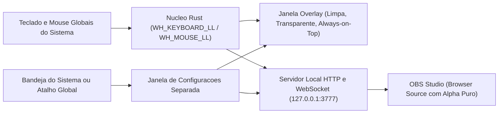

# Teglato

[](https://github.com/ezequielfb/teglato/actions/workflows/ci.yml)
[](https://github.com/ezequielfb/teglato/actions/workflows/release.yml)

[](LICENSE)

Um gatinho reativo para a área de trabalho inspirado no **LittleOne (小只)** — leve, 100% vetorial, transparente, sempre no topo sobre jogos e aplicativos, e pronto para usar no **OBS Studio** sem precisar instalar nada.

---

## Baixar e Rodar (Sem Instalação)

Qualquer pessoa pode baixar e executar diretamente no **Windows 10 ou Windows 11**, sem precisar instalar Node.js, Rust ou qualquer dependência:

[-f5be41?style=for-the-badge&logo=windows&logoColor=14151a)](https://github.com/ezequielfb/teglato/releases/latest/download/Teglato.exe)

1. Clique no botão [**Baixar Teglato.exe**](https://github.com/ezequielfb/teglato/releases/latest/download/Teglato.exe) acima.
2. Dê duplo clique no **`Teglato.exe`** baixado — o gatinho já abre posicionado no canto inferior direito da tela, logo acima da barra de tarefas, e memoriza onde você deixá-lo ao fechar.
3. Pronto! A janela do gato é **100% limpa** (sem botões ou molduras) e os cliques nas áreas transparentes atravessam direto para os programas de trás.

> [!NOTE]
> Se abrir a página de [**Releases**](https://github.com/ezequielfb/teglato/releases/latest), baixe apenas **`Teglato.exe`**. Os arquivos `Source code (zip)` / `Source code (tar.gz)` são gerados automaticamente pelo GitHub apenas para quem programa.

---

## Controles e Atalhos

| Ação | Como fazer |
| :--- | :--- |
| **Mover o gato pela tela** | Clique e arraste sobre o gato ou a mesinha (quando destravado) |
| **Abrir Configurações e trocar pelagem** | Clique no ícone do **Teglato** perto do relógio (Bandeja do Windows) ou pressione `Ctrl + Shift + ,` |
| **Travar / destravar posição (*Click-Through* total)** | Pressione `Ctrl + Shift + L` ou marque **Travar Posição** na Bandeja |
| **Resetar posição padrão** | Botão **Resetar Posição** nas Configurações ou na Bandeja |
| **Fechar o aplicativo** | Clique com o botão direito no ícone da Bandeja → **Sair** |

---

## Usar no OBS Studio (Fundo Transparente)

O **Teglato** já embute um servidor local exclusivo para captura cristalina no OBS:

1. No OBS Studio, clique em **+** (Fontes) → **Navegador (*Browser Source*)**.
2. Em **URL**, cole:
   ```text
   http://127.0.0.1:3777/?obs=1
   ```
3. Defina largura e altura na proporção **4:3** (ex.: `480` × `360` ou `800` × `600`).

> [!TIP]
> A cena no OBS entra com **canal Alpha 100% transparente** automaticamente (sem precisar de *Chroma Key*), acompanha a troca de pelagens em tempo real e continua funcionando mesmo se você mover ou travar o gato na sua tela.

---

## Destaques

- **13 pelagens incluídas desde o início:** `Tuxedo` (Frajola), `Orange tabby`, `Brown tabby`, `Calico`, `Siamese`, `Black`, `White`, `Blue gray`, `Gray & white`, `Orange & white`, `Tortoiseshell`, `Cream` e `Silver`.
- **Digitação e mouse fiéis ao original:** Cada tecla física acende e abaixa na tecla equivalente do mini teclado em perspectiva (com suporte a teclados ABNT2/PT-BR e *numpad*), enquanto a pata esquerda do gato digita livremente sem soltar o mouse durante o uso simultâneo.
- **Teclas flutuantes ao digitar:** A tecla pressionada sobe suavemente do mini teclado e desaparece com *fade-out* (ativado por padrão e configurável em `Ctrl + Shift + ,`).
- **Vida própria:** Piscadas aleatórias, cauda balançando, modo sono após inatividade configurável (`Zzz`) e chacoalhada na cabeça ao acordar.
- **Áudio opcional:** Cliques suaves de teclado/mouse e ronronar sintetizados via Web Audio API (desativado por padrão; configurável em `Ctrl + Shift + ,`).

---

## Dúvidas Comuns (FAQ)

<details>
<summary><strong>O Windows mostrou um aviso azul ("O Windows protegeu o computador" / SmartScreen). É seguro?</strong></summary>

Sim. Esse aviso aparece em qualquer executável independente que ainda não possui um certificado pago de assinatura digital (*Code Signing*). Para abrir, clique em **Mais informações** → **Executar assim mesmo**. Se quiser confirmar a integridade do arquivo baixado, compare o hash SHA-256 com o arquivo `SHA256SUMS.txt` publicado na mesma release:

```powershell
Get-FileHash .\Teglato.exe -Algorithm SHA256
```

</details>

<details>
<summary><strong>O aplicativo lê ou envia o que eu digito (senhas, mensagens)?</strong></summary>

**Não.** O hook global do Windows captura apenas o código físico da tecla (para saber qual tecla acender no tecladinho) e a posição relativa do cursor. Nenhum texto, senha ou dado é gravado em disco ou enviado para a internet — inclusive o servidor do OBS escuta estritamente em `127.0.0.1` (local).

</details>

<details>
<summary><strong>Como desinstalar?</strong></summary>

Como o `Teglato.exe` é portátil, basta fechá-lo pela Bandeja do Sistema e apagar o arquivo `.exe` (se quiser remover também suas preferências salvas, apague a pasta `%AppData%\com.teglato.app`).

</details>

---

## Para Desenvolvedores e Contribuidores

O projeto usa **Tauri v2 (Rust + TypeScript / HTML5 Canvas 2D)** para unir executável pequeno, baixo uso de memória (~35–60 MB RAM) e manutenção simples — cerca de **90% do código visual, pelagens, animações e áudio está em TypeScript**.



### Estrutura Enxuta

```text
teglato/
├── .github/workflows/    # CI (testes) e Release (gera Teglato.exe portátil)
├── src/
│   ├── shared/           # Tipos (AppConfig, InputEvent) e mapa de 63 teclas + ABNT2
│   └── renderer/         # Canvas 2D, 13 pelagens, estado das patas, áudio e janela Settings
├── src-tauri/            # Backend nativo Rust (hook global, tray, atalhos, OBS server e store)
├── tests/                # Testes unitários Vitest (teclado, pelagens e máquina de estados)
├── CONTRIBUTING.md       # Guia rápido para modificar ou adicionar pelagens
├── CHANGELOG.md          # Histórico de versões
└── LICENSE               # Licença MIT
```

### Comandos Rápidos

```bash
# Instalar dependências do frontend
npm install

# Pré-visualizar a cena e configurações direto no navegador (sem precisar de Rust)
npm run dev

# Rodar testes e checagem de tipos
npm test && npm run typecheck

# Rodar testes do backend Rust
npm run build && cd src-tauri && cargo test --features custom-protocol

# Gerar executável único portátil local (requer Rust + VS C++ Build Tools no Windows)
npm run build:portable
```

Quer adicionar novas pelagens, ajustar animações ou enviar melhorias? Veja o guia em [CONTRIBUTING.md](CONTRIBUTING.md).

---

## Documentação Relacionada

- [Guia de Contribuição](CONTRIBUTING.md)
- [Histórico de Alterações (Changelog)](CHANGELOG.md)
- [Licença (MIT)](LICENSE)
